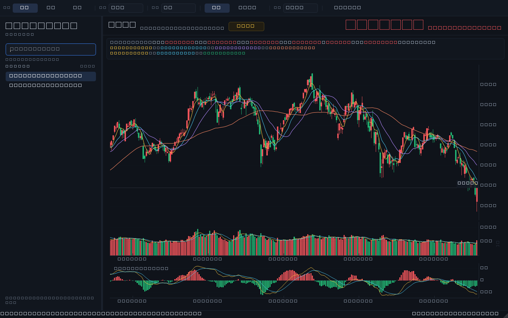

# KLineDeck

A 股 K 线工作台：Qt + pyqtgraph 自绘蜡烛图，行情来自 Baostock。



## 功能

- 日 / 周 / 月 K，前复权、后复权、不复权切换
- 1 月 / 3 月 / 6 月 / 1 年 / 3 年 / 全部区间；滚轮缩放、拖拽平移
- 主图 MA5/10/20/60、BOLL(20,2)，成交量 MA5/10
- 副图 MACD(12,26,9)、KDJ(9,3,3)、RSI(6,12,24)，可随时切换
- 十字光标同步显示 OHLC、涨跌幅、成交量、换手率、均线与指标读数
- 全历史视图自动切换收盘线，避免上千根蜡烛挤成一团；Y 轴随可见区间自适应
- A 股与指数本地搜索、自选股持久化、导出 PNG；搜索不访问网络，港股/美股不在支持范围
- 行情头部 ★ 一键加入/移出自选；自选列表双击加载、右键管理
- 本地缓存 + 增量刷新：首屏只取最近 3 年，向左拖到边界自动补更早历史，「全部」按需补全
- 深色主题、高 DPI、日期轴随缩放切换粒度

## 运行

需要 Python 3.12+ 与 [uv](https://docs.astral.sh/uv/)。

```bash
uv sync
uv run python main.py
```

首次查询需要联网，之后走本地缓存。Baostock 免费、无需 token。自选股保存在系统配置目录，Windows 下是
`%LOCALAPPDATA%/KLineDeck/KLineDeck/watchlist.json`；K 线缓存在 `%LOCALAPPDATA%/KLineDeck/cache/<数据源>/`，
也可用环境变量 `KLINEDECK_CACHE_DIR` 指定。缓存 6 小时后增量刷新，除权导致复权价变化时会自动整段重取。
旧版 CandleLine 的缓存与自选会在首次启动时自动复制到新目录。

## 结构

| 路径 | 职责 |
| --- | --- |
| `main.py` | 入口：QApplication、主题、主窗口 |
| `klinedeck/models.py` | `Stock` / `Bars` / `DataError` |
| `klinedeck/data.py` | 数据源调度、缓存与增量刷新 |
| `klinedeck/sources/base.py` | `MarketDataSource` 接口 |
| `klinedeck/sources/baostock_source.py` | Baostock 会话、搜索与复权 K 线解析 |
| `klinedeck/cache.py` | npz 缓存、增量合并、复权因子校验 |
| `klinedeck/chart.py` | K 线控件：价格、成交量、副图、十字光标、缩放 |
| `klinedeck/chart_view.py` | 区间映射、视口保持与补历史触发 |
| `klinedeck/header.py` | 名称、代码、最新价与涨跌 |
| `klinedeck/stock_directory.py` | 本地 A 股/指数目录搜索 |
| `klinedeck/stock_directory.csv` | 目录快照（约 5500 条） |
| `klinedeck/items.py` | 蜡烛图元、日期轴、均线计算 |
| `klinedeck/indicators.py` | SMA/EMA/MACD/KDJ/RSI/BOLL 计算 |
| `klinedeck/indicator_panel.py` | MACD/KDJ/RSI 副图绘制与读数 |
| `klinedeck/overlays.py` | BOLL、成交量均线、最新价线 |
| `klinedeck/crosshair.py` | 跨价格/成交量/副图的十字光标 |
| `klinedeck/info.py` | OHLC、均线与指标信息栏 |
| `klinedeck/sidebar.py` | 搜索与自选 |
| `klinedeck/toolbar.py` | 周期、复权、区间、叠加指标与导出 |
| `klinedeck/window.py` | 主窗口、异步加载、完整历史补全与向左补历史 |
| `klinedeck/window_layout.py` | 中央布局与状态栏 |
| `tests/test_indicators.py` | 指标公式回归测试 |
| `tests/test_data.py` | 向前补历史、缓存合并与本地目录测试 |
| `klinedeck/theme.py` | 配色与 QSS |

## 扩展数据源

默认使用 Baostock。新增数据源只需实现 `MarketDataSource` 的三个方法，并在创建窗口前注册：

```python
from klinedeck import data

class MySource:
    name = "my"
    def full_start(self, freq: str) -> str: ...
    def search(self, keyword: str): ...
    def fetch(self, code, freq, adjust, is_index, start, end=None): ...

data.set_source(MySource())
```

搜索与 K 线都会走同一数据源；缓存按 `name` 隔离，不会与 Baostock 的缓存混用。

## 性能

| 场景 | 实测 |
| --- | --- |
| 首次加载最近 3 年 | 0.8–8.5 s（Baostock 波动较大） |
| 二次打开（缓存命中） | 约 0.01 s |
| 缓存过期后的增量刷新 | 约 0.06 s（无新 K 线时） |
| 首次补全 2010 年起的全部日线 | 6–40 s |
| 全部历史二次打开 | 约 0.01 s |
| 4078 根全量指标计算 | 约 26 ms（一次性） |

周 / 月线数据量小，一次取全量，首次约 1 s。

## 测试

```bash
uv run python -m unittest discover -s tests -v
```

## 说明

- 搜索使用随包附带的本地 A 股目录快照，输入后立即返回；腾讯等港股、美股不在目录中，会直接提示无匹配，不会等待在线查询。行情仍由 Baostock 提供。
- 向左拖动接近缓存起点时，会自动向前补约 2 年日线；补齐后按完整序列重算均线与指标，视口保持原日期区间。
- 成交量均线对缺失成交量按可用值计算，不会因单日缺数中断整条线。
- MACD 柱按国内软件惯例取 `2 * (DIF - DEA)`；KDJ、RSI 使用 Wilder 平滑。
- 数据仅供学习研究，不构成投资建议。
- 默认前复权。周 / 月线没有 `preclose` 字段，涨跌额按上一周期收盘价计算。
